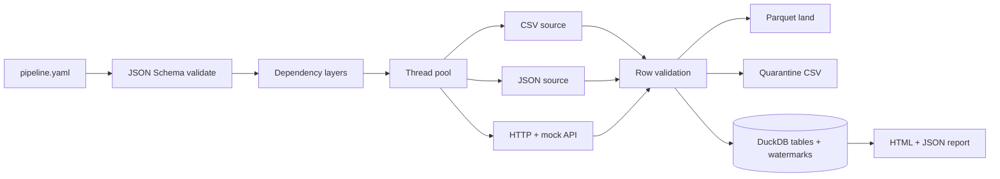

# Metadata-Driven Ingestion Framework

I built this as a small Python framework where ingestion pipelines are described in YAML, in the spirit of Azure Data Factory. The engine reads the config and does the work. Adding a source means adding a config block, not writing new Python.

This is **not** Azure Data Factory. It is an ADF-style metadata-driven pattern implemented in plain Python, running offline against fixtures and a local mock HTTP API. There are no Azure resources, no integration runtime, and no real cloud triggers.

Live report: https://rahul9121.github.io/metadata-driven-ingestion/

## Why I built it

I wanted a portfolio piece that shows how I think about ingestion: config first, clear failure modes, retries that only apply to transient errors, quarantine for bad rows, watermarks for incremental loads, and a run log you can actually read. Interview conversations about ADF map cleanly onto this code without pretending I deployed a factory in Azure for the demo.

## Architecture



## Example config

```yaml
sources:
  - name: orders_json
    type: json
    path: fixtures/json/orders.json
    target: fact_orders
    load_mode: incremental
    watermark_column: order_ts
    depends_on: [customers_csv]
    on_failure: quarantine
    retry:
      attempts: 2
      backoff_base_seconds: 0.1
      jitter: true
    validation:
      not_null: [order_id, customer_id]
      ranges:
        amount: { min: 0, max: 100000 }
    condition:
      type: rows_gt
      source: customers_csv
      value: 0
```

Secrets are not hard-coded. Header values can use `${MDIF_API_TOKEN}` and resolve from the environment.

## Run in three commands

```bash
python -m venv .venv
# Windows: .venv\Scripts\activate
# Unix: source .venv/bin/activate
pip install -r requirements.txt && pip install -e .
python -m mdif run --config config/pipeline.yaml
python -m mdif report --out docs
```

Or with Make: `make setup && make run && make report && make serve`.

CLI commands: `validate`, `run`, `dry-run`, `report`.

## How to add a new source

1. Drop a fixture under `fixtures/` (or point at a local mock URL).
2. Append a block under `sources` in `config/pipeline.yaml`.
3. Set `type`, `path` or `url`, `target`, optional `depends_on`, `validation`, `retry`, `load_mode`.
4. Run `python -m mdif validate` then `python -m mdif run`.

No new Python is required for a standard CSV, JSON, or HTTP source.

## What the engine does

- Validates config up front with JSON Schema and fails fast.
- Orders sources by `depends_on` and runs independent sources concurrently.
- Classifies errors as transient (retry with exponential backoff and jitter) or permanent (stop).
- Lands raw data as Parquet, loads good rows into DuckDB, writes rejects to quarantine with reasons.
- Keeps watermarks and a structured run log for idempotent reruns.
- Skips downstream sources when a dependency fails and records why.
- Builds source-to-target lineage from config for the report page.

The demo includes a deliberately failing `broken_feed` source so the report shows a real failure path and a skipped downstream step. The mock HTTP API fails the first calls, returns a 429, serves a malformed page, then returns clean data so retries are visible.

## ADF concept mapping

| ADF concept | In this project | Status |
|---|---|---|
| Pipeline | YAML + runner | Implemented (simplified) |
| Copy activity | Extract, validate, load | Implemented (simplified) |
| ForEach | `foreach` over file list | Implemented (list only) |
| If condition | `rows_gt` on upstream counts | Implemented (minimal) |
| Linked service | type + path/url, `${ENV}` secrets | Pattern only |
| Dataset | path/url + target table | Implemented (simplified) |
| Parameters | `pipeline.parameters` | Implemented |
| Retry policy | attempts, backoff, jitter, timeout | Implemented |
| Triggers | CLI / GitHub Actions only | Not implemented |
| Integration runtime | In-process thread pool | Not implemented |
| Monitoring | Run log + static HTML report | Implemented (offline) |
| Azure resources | None | Not implemented |

## Project layout

```
config/pipeline.yaml   # pipeline definition
config/schema.json     # JSON Schema
src/mdif/              # package: config, engine, sources, report, CLI
fixtures/              # offline CSV/JSON seeds
tests/                 # focused unit/integration tests
docs/                  # GitHub Pages report output
```

## Limitations

- Single-machine only. No distributed execution.
- Three source types. No databases, queues, or cloud storage connectors.
- Conditions and ForEach are minimal on purpose.
- Lineage is config-derived, not runtime column-level lineage.
- The mock API is local demo infrastructure, not a production service map.
- No scheduling product; CI runs the pipeline on push.

## License

MIT
